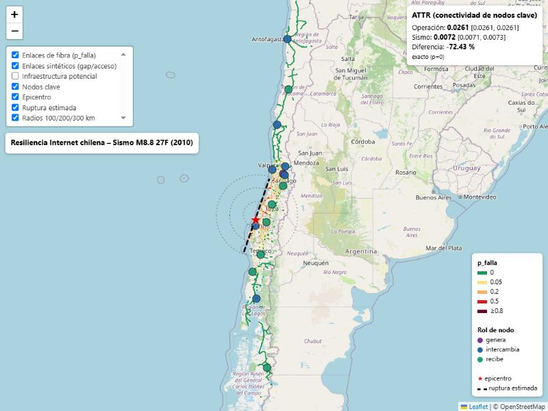
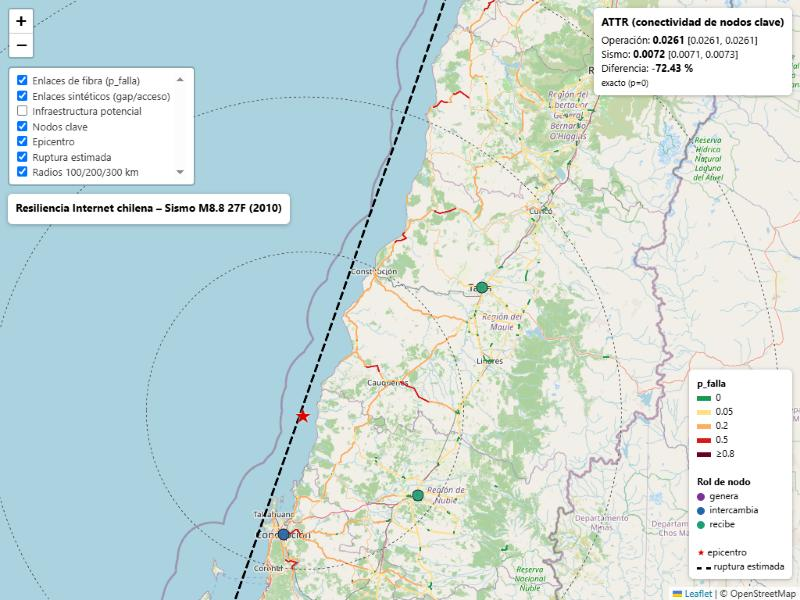

# Tarea 2: resiliencia de la Internet chilena ante el sismo M8.8 del 27F (2010)

Infraestructura de fibra óptica chilena (respuesta SAIP AN002T0005610 de SUBTEL, levantamiento del
*Estudio y Recomendaciones sobre la Resiliencia de la infraestructura de la Internet chilena*, proyecto
CORFO 15BPE-47225, "Yafún") modelada en **PostgreSQL + PostGIS + pgRouting**. Se calcula el **ATTR**
(*Average Two-Terminal Reliability*) entre los nodos clave antes y después del terremoto M8.8 del Maule
y se muestra en un mapa **Leaflet**.

| | ATTR nodos clave |
|---|---|
| Red en operación | **0,02614** (exacto) |
| Tras el sismo M8.8 | **0,00721** (Monte Carlo N = 10 000, IC95 [0,00711; 0,00731]) |
| Diferencia | **−0,01894 (−72,4 %)** |

---

## 1. Ejecución: un solo comando

Requisitos: Ubuntu, nativo o en **WSL** (probado en Ubuntu 26.04, PostgreSQL 18, PostGIS 3.6, pgRouting 4.0.1, Python 3).

```bash
# Prerrequisitos (una sola vez; pide la clave sudo)
bash scripts/setup_wsl.sh

# TODO el flujo: crea la BD, carga los datos, arma la topología, calcula las probabilidades, los ATTR y abre el mapa
python3 main.py
```

Desde Windows: `wsl -d Ubuntu -- bash -c "cd /mnt/c/.../tarea2-resiliencia && python3 main.py"`.
El mapa queda en **http://localhost:8000**. WSL reenvía `localhost` a Windows, así que se abre con el navegador de Windows.

`python3 main.py` (= `all`) ejecuta en orden:

| Paso | Qué hace | Archivo |
|---|---|---|
| 1 | `DROP/CREATE DATABASE resiliencia` | `main.py` |
| 2 | Extensiones PostGIS y pgRouting, más la compatibilidad de `pgr_createTopology` | `sql/01_esquema.sql`, `sql/00_compat_pgrouting.sql` |
| 3 | Carga de los 4 shapefiles (pyshp → `ST_GeomFromGeoJSON`) | `main.py` |
| 4 | Carga del GeoJSON del USGS (jsonb) y extracción del sismo y de la ruptura | `sql/04_sismo.sql` |
| 5 | Noding, `pgr_createTopology`, componentes, nodos clave y enlaces de acceso | `sql/02_topologia.sql`, `sql/03_nodos_clave.sql` |
| 6 | Modelo de falla: `p_falla` de cada enlace | `sql/05_modelo_falla.sql` |
| 6b | Exporta **`main.sql`** (infraestructura con las probabilidades) | `scripts/exportar_main_sql.py` |
| 7 | ATTR en operación y tras el sismo | `scripts/attr.py` |
| 8 | Exporta las capas GeoJSON y sirve el mapa Leaflet | `web/index.html` |

Otros subcomandos: `initdb`, `attr [-n N]`, `mapa`, `dump`, `calibrar`, y `all --no-serve` (todo sin levantar el servidor).
La conexión se configura con `PGHOST`, `PGPORT`, `PGUSER` y `PGPASSWORD` (valores por defecto: `localhost`, `5432`,
`postgres`, `postgres`; los deja así `setup_wsl.sh`). Los resultados son deterministas (semilla 2010) y la
salida completa queda en `resultados/salida_main.txt`.

**Dependencias Python** (`requirements.txt`; en Ubuntu se instalan como paquetes `python3-*`):
`psycopg2` (conexión a PostgreSQL), `pyshp` (lectura de shapefiles sin GDAL), `numpy` y `scipy`
(`scipy.sparse.csgraph.connected_components`, usado para el Monte Carlo del ATTR). Para el mapa basta la librería estándar
(`http.server`) y Leaflet 1.9.4 desde CDN.

**Cargar solo `main.sql`** en una BD vacía:
```bash
createdb prueba && psql -d prueba -f main.sql
```

### Estructura
```
main.py                 orquestador (un solo comando)
main.sql                entregable: infraestructura + probabilidades de falla (carga en BD vacía)
sql/00_compat_pgrouting.sql  pgr_createTopology (pgRouting 4 la eliminó, ver §3)
sql/01..05_*.sql        esquema, topología, nodos clave, sismo, modelo de falla
scripts/attr.py         ATTR (exacto / Monte Carlo)
scripts/calibrar_tolerancia.py, scripts/exportar_main_sql.py, scripts/setup_wsl.sh
data/shp/               4 capas SAIP (fibra, ferry, postación, camino sin postación)
data/usgs_usp000h7rf.geojson  sismo descargado del USGS
web/                    mapa Leaflet (index.html + data/*.geojson generados)
resultados/             attr.json, attr_pares.csv, salida_main.txt
docs/                   capturas del mapa
```

---

## 2. Nodos clave (generan / intercambian / reciben información)

**Criterio.** El Estudio modela la red física con las **comunas como nodos** (§5.3: 346 comunas y 8 puntos
limítrofes) y recomienda estudiar los **PIT y data centers** (§7, recomendación 4); su capa
`mapa_cables_submarinos_nodos` toma como fuente submarinecablemap.com. A partir de eso se definen tres roles:

* **Genera:** concentra contenido y servidores (data centers).
* **Intercambia:** intercambio de tráfico entre redes (IXP) o hacia el exterior (aterrizajes de cables submarinos y la troncal internacional terrestre).
* **Recibe:** capitales regionales que agregan y distribuyen el tráfico de su región.

| cod | Nodo | Rol | Tipo | Fuente |
|---|---|---|---|---|
| SCL_PIT | Santiago: PIT Chile / NAP Chile | intercambia | IXP | pitchile.cl; Estudio §7 |
| SCL_DC | Quilicura: clúster de data centers | genera | data center | Estudio §7 |
| VAP | Valparaíso: SAm-1, SAC, Curie | intercambia | aterrizaje de cable | submarinecablemap.com |
| ARI | Arica: SAm-1, Prat | intercambia | aterrizaje | submarinecablemap.com; GTD |
| IQQ / ANF / LSC | Iquique / Antofagasta / La Serena: Prat | intercambia | aterrizaje | GTD (cable Prat) |
| CCP | Concepción-Talcahuano: Prat, hub regional | intercambia | aterrizaje | GTD |
| PMC | Puerto Montt: Prat y Fibra Óptica Austral | intercambia | aterrizaje | GTD; SUBTEL FOA |
| PUQ | Punta Arenas: Fibra Óptica Austral | intercambia | aterrizaje | SUBTEL FOA |
| LAN | Los Andes: troncal internacional (Cristo Redentor) | intercambia | troncal internacional | Estudio §6 (puntos limítrofes) |
| CPO, RCG, TLC, CHL, TCO, VLD, COY | capitales regionales | recibe | troncal / capital | Estudio §5.3 |

Ubicación y vértice asignado: tabla `nodos_clave` (`cod, rol, tipo, fuente, geom, vertex_id, componente, dist_acceso_m`).
Cada nodo se une al vértice de fibra más cercano mediante un **enlace sintético de acceso** (§3).

---

## 3. Topología con `pgr_createTopology`

1. **Datos.** La capa `fibra_optica_detectada` tiene 1 915 registros y **10 312,8 km**. El ferry (2 390 km), la postación
   (6 712 km) y los caminos sin postación (8 108 km) se cargan como *infraestructura potencial* (capa gris en el
   mapa), porque **no transportan datos** y no forman parte de la red en operación.
2. **Proyección.** Todo el cálculo métrico se hace en **EPSG:32719** (UTM 19S, metros).
3. **Noding.** `ST_Node` divide las líneas en sus cruces y uniones en T, que de otro modo no compartirían vértice.
4. **`pgr_createTopology('edges', 5.0, 'geom', 'id', clean := true)`.** pgRouting 4.0 (el paquete de Ubuntu 26.04)
   **eliminó** esta función. Como en pgRouting 3.x era PL/pgSQL, `sql/00_compat_pgrouting.sql` la reimplementa con la
   misma firma y algoritmo (une extremos a un vértice existente a ≤ tolerancia o crea uno nuevo, y genera
   `edges_vertices_pgr`). Si el servidor trae la función nativa (3.x), se usa esa.
5. **Tolerancia de 5 m.** Se calibró con `python3 main.py calibrar` (tabla `calibracion_tolerancia`):

   | tol (m) | 0,1 | 0,5 | 1 | 2 | **5** | 10 | 25 | 50 |
   |---|---|---|---|---|---|---|---|---|
   | vértices | 2083 | 2083 | 2081 | 2081 | **2070** | 2066 | 2065 | 2059 |
   | componentes | 129 | 129 | 129 | 129 | **126** | 126 | 126 | 126 |
   | % comp. mayor | 16,1 | 16,1 | 16,1 | 16,1 | **16,2** | 16,2 | 16,2 | 16,1 |

   Con 5 m se unen los extremos digitalizados casi coincidentes (es el orden del error de un GPS de mano). Desde ahí la red
   no cambia (meseta) y no hay riesgo de fusionar nodos distintos.
   Tabla de vértices resultante (`SELECT id, cnt, chk, ein, eout, ST_AsText(ST_Transform(the_geom,4326)) FROM edges_vertices_pgr`):

   ```
    id | cnt | chk | ein | eout |                     geom
   ----+-----+-----+-----+------+-----------------------------------------------
     1 |   3 |     |     |      | POINT(-73.41559148034696 -37.62107935567063)
     2 |   2 |     |     |      | POINT(-73.46186951233959 -37.62716353006536)
     3 |   2 |     |     |      | POINT(-73.4642671568597 -37.62782264738397)
     4 |   2 |     |     |      | POINT(-73.54949259047122 -37.663436146498526)
     5 |   2 |     |     |      | POINT(-73.66034585376609 -37.620943121251436)
   (2087 vértices en total)
   ```
6. **Columna de falla.** `edges.p_falla double precision NOT NULL DEFAULT 0`: vale 0 en operación y la actualiza el modelo sísmico (§5).

   ```
    column_name |    data_type     | column_default
   -------------+------------------+----------------
    source      | integer          |
    target      | integer          |
    p_falla     | double precision | 0
    sintetico   | boolean          | false
   ```
7. **Conectividad** (`pgr_connectedComponents`, tablas `componentes` y `resumen_componentes`): **2 087 vértices,
   2 040 enlaces y 126 componentes**. La mayor tiene 339 vértices (**16,2 %**, 1 952 km, Santiago–La Serena). Hay
   414 extremos colgantes, 46 componentes de una sola arista y 65 de menos de 10 km. Esto **coincide con el
   Estudio** (§5.3: componente conexa mayor de 59 comunas, 17,1 %, y tolerancia a fallas 0 porque la red no es conexa).

**Enlaces sintéticos** (`edges.sintetico = true`, línea punteada en el mapa):
* `acceso` (18 enlaces, 20 km en total): unen cada nodo clave con el vértice de fibra más cercano (máximo 20 km).
  El más largo es el de SCL_PIT (10,7 km), porque el Estudio levantó la fibra **interurbana** a lo largo de caminos
  y no el tendido urbano de Santiago.
* `gap`: cierran los huecos de digitalización entre un extremo colgante y otra componente (≤ `T2_GAP`, por defecto 300 m).
  Con 300 m **no se agrega ninguno**: la fragmentación no se debe a micro-huecos. Sensibilidad del ATTR al umbral
  (`T2_GAP=… python3 main.py`):

  | GAP | enlaces gap | componentes | ATTR operación | ATTR sismo | Δ % |
  |---|---|---|---|---|---|
  | 300 m | 0 | 126 | 0,0261 | 0,0072 | −72,4 |
  | 1 km | 4 | 122 | 0,0261 | 0,0071 | −73,0 |
  | 2 km | 19 | 112 | 0,0327 | 0,0112 | −65,6 |
  | 5 km | 62 | 90 | 0,0523 | 0,0139 | −73,5 |

**Limitaciones de los datos.**
* El archivo SAIP trae **~10 300 km de fibra**. Esto coincide con los km de camino con fibra del Cuadro 4.1 del Estudio
  (7 188 + 2 244 + 622 + 110 + 178 = 10 342 km), pero el levantamiento total del Estudio es mayor (26 534 km
  documentados, enunciado: ~28 000 km) porque suma electricidad, cobre, ferry y caminos sin cableado.
* Los tramos dobles, triples o cuádruples vienen como una sola línea, así que no se modela la redundancia paralela.
* No incluye la fibra urbana, los cables submarinos ni los enlaces de microondas o satelitales.
* Se excluyen las 6 partes de Isla de Pascua (19,6 km, lon < −100), que no tienen conexión terrestre.
* Parte de la fibra no se pudo verificar en forma continua desde el camino (Estudio §5.3: 89,3 % de las comunas
  con fibra, pero conectividad asegurada solo en el 76,6 %). Por eso la red aparece fragmentada.

---

## 4. ATTR: definición y script (`scripts/attr.py`)

Sea $K$ el conjunto de nodos clave ($|K| = 18$) y $p_e$ la probabilidad de falla de cada enlace $e$, con fallas
independientes. Entonces:

$$\mathrm{ATTR} = \frac{2}{|K|(|K|-1)} \sum_{i<j,\; i,j \in K} \Pr\left[\, i \leftrightarrow j \text{ conectados} \,\right]$$

Es el promedio, sobre los pares de nodos clave, de la probabilidad de que el par siga conectado. Esta métrica es la
*Average Two-Terminal Reliability* de **Neumayer & Modiano (2010)**, *Network Reliability with Geographically Correlated
Failures*, IEEE INFOCOM, y de **Neumayer, Zussman, Cohen & Modiano (2011)**, *Assessing the Vulnerability of the Fiber
Infrastructure to Disasters*, IEEE/ACM Trans. on Networking 19(6). Vale 1 si todos los pares quedan conectados.

**Método.** El script lee de la BD `edges(source, target, p_falla)` y `nodos_clave.vertex_id`.
* **En operación** ($p_e = 0$): cálculo **exacto** con un solo `connected_components`.
* **Tras el sismo:** el cálculo exacto es #P-difícil ($2^{2040}$ estados), así que se usa **Monte Carlo**. En cada
  iteración, cada enlace sobrevive con probabilidad $1-p_e$, se calculan las componentes y se registra qué pares
  quedan conectados. Antes de iterar se contraen los enlaces con $p_e = 0$.
* **N = 10 000 (semilla 2010).** El error estándar de cada par es $\le 0{,}5/\sqrt{N} = 0{,}005$ y el IC95 del ATTR es de
  ±0,0001, más de 100 veces menor que el cambio que se quiere medir. Tarda unos 4 s.
* Salidas: `resultados/attr.json`, la matriz de pares `resultados/attr_pares.csv` y la tabla `resultados_attr`.

### 4.1 ATTR en operación = 0,02614 (exacto)

Salida de `main.py` (paso 7): `ATTR = 0.026144  exacto (p=0)`.

**Interpretación.** De los 153 pares de nodos clave **solo 4 están conectados**:
SCL_PIT–SCL_DC, SCL_PIT–LSC, SCL_DC–LSC (componente Santiago–La Serena, 1 952 km) y CCP–CHL (Concepción–Chillán,
1 087 km). Los otros 14 nodos clave quedan en componentes distintas: Valparaíso (73 km de fibra propia), Rancagua,
Talca, Los Andes, Temuco, Valdivia, Puerto Montt, Coyhaique, Punta Arenas y todo el norte (Arica, Iquique,
Antofagasta, Copiapó). Así, **ni siquiera sin sismo la red física levantada conecta el país** y el ATTR all-terminal
es 0. Esto coincide con el diagnóstico del Estudio (tolerancia a fallas 0, componente mayor 17 %).

---

## 5. Terremoto M8.8

### 5.1 Datos del USGS en la BD
Consulta al catálogo ComCat del USGS por ID de evento:
`https://earthquake.usgs.gov/fdsnws/event/1/query?eventid=usp000h7rf&format=geojson`, guardada en
`data/usgs_usp000h7rf.geojson` (`main.py` la vuelve a descargar si falta).
El documento se guarda **crudo** en `sismo_geojson.doc (jsonb)` y `sql/04_sismo.sql` extrae los campos con
`ST_GeomFromGeoJSON` y operadores jsonb, sin coordenadas escritas a mano:

| evento_id | mag | fecha | profundidad | strike | geom |
|---|---|---|---|---|---|
| official20100227063411530_30 | 8.8 | 2010-02-27 03:34:11 −03 | 22,9 km | 17° (tensor de momento USGS) | POINT(−72.898 −36.122) |

### 5.2 Modelo de falla probabilístico

El modelo tiene tres etapas, la intensidad del movimiento, el daño por km de cable y la probabilidad de corte del enlace:

**(a) Fuente.** Un M8.8 rompe una falla de unos 500 km, no un punto. A partir del epicentro se construye una **ruptura
lineal** centrada en él y orientada según el *strike* del tensor de momento del USGS (17°). Su largo sale de
**Wells & Coppersmith (1994)**, BSSA 84(4): $\log_{10} L = -2{,}44 + 0{,}59\,M \Rightarrow L = 565$ km, del orden de los
~500 km observados para el 27F. Distancia: $R = \sqrt{d_{ruptura}^2 + h^2}$, con $h = 22{,}9$ km.

**(b) Atenuación de PGA: Youngs, Chiou, Silva & Humphrey (1997)**, *Strong ground motion attenuation relationships for
subduction zone earthquakes*, SRL 68(1). Se usa la ecuación de **interfaz** ($Z_t = 0$) en **roca**, para PGA
($C_1 = C_2 = 0$):

$$\ln \mathrm{PGA}[g] = 0{,}2418 + 1{,}414\,M - 2{,}552\,\ln\!\left(R + 1{,}7818\, e^{0{,}554 M}\right) + 0{,}00607\,h$$

Se eligió porque es una GMPE desarrollada para **subducción**, incluye datos chilenos y la saturación de campo cercano
para grandes magnitudes. Por ejemplo, PGA(R = 50 km) = 0,205 g.

**(c) De PGA a PGV a daño por km.**
* $\mathrm{PGV} = 121{,}9 \cdot \mathrm{PGA}$ [cm/s], con la razón v/a = 48 in/s/g de **Newmark & Hall (1982)**,
  *Earthquake Spectra and Design* (EERI), para suelo aluvial, que es donde corren los caminos con fibra.
* Tasa de daño de líneas enterradas: **FEMA Hazus Earthquake Model Technical Manual** (cap. "Utility Systems", *pipelines*),
  basada en **O'Rourke & Ayala (1993)**: $RR = K \cdot 0{,}0001 \cdot \mathrm{PGV}^{2{,}25}$ [roturas/km], con
  $K = 0{,}3$ para material **dúctil**.
* Si las roturas siguen un proceso de Poisson a lo largo del enlace (el supuesto de Hazus), un enlace de largo $L_e$
  queda cortado si tiene al menos una rotura:

$$p_e = 1 - \exp\left(-RR \cdot L_e\right) \in [0, 1]$$

**Por qué se adapta a fibra.** Un cable de fibra es una línea continua, como una tubería: se corta en cuanto hay una
falla en cualquier punto, y la probabilidad crece con el largo y la intensidad. Por eso un modelo de tasa por km es más
apropiado que una curva de fragilidad puntual. El cable es flexible y tolera deformación, de ahí $K = 0{,}3$ (dúctil).
El 98 % de la fibra es **aérea** (Estudio, Cuadro 4.1), de modo que el daño real lo determina el soporte (postes,
puentes). Usar la relación de Hazus para enterradas es una aproximación, y los parámetros quedan editables en la tabla
`modelo_param` (cada fila con su fuente).

### 5.3 Script de probabilidades (`sql/05_modelo_falla.sql`)
Un `UPDATE edges` aplica el modelo a cada enlace con `ST_Distance(e.geom, ruptura.geom)` en **EPSG:32719 (metros)**.
Guarda `dist_ruptura_km, pga_g, pgv_cms, rr_km, p_falla` y expone la vista `v_probabilidad_falla`.
Las funciones SQL `pga_youngs()` y `p_falla_enlace()` quedan también en `main.sql`.

**Más afectados** (enlaces de ≥ 1 km):

| id | lat, lon (centro) | largo | dist. ruptura | PGA | p_falla |
|---|---|---|---|---|---|
| 4 | −37,65, −73,61 (Arauco) | 12,2 km | 0 km | 0,264 g | **0,594** |
| 124 | −36,98, −72,96 (Gran Concepción) | 13,9 km | 20 km | 0,246 g | 0,584 |
| 164 | −36,80, −72,97 (Gran Concepción) | 12,7 km | 14 km | 0,254 g | 0,578 |
| 584 | −36,02, −72,12 (Ñuble) | 23,1 km | 52 km | 0,193 g | 0,570 |
| 550 | −35,14, −72,20 (Maule) | 13,1 km | 20 km | 0,246 g | 0,563 |

**Menos afectados:** los enlaces del extremo norte (> 1 650 km, PGA ≈ 0,001 g), con $p_e \approx 0$.
Por banda de distancia:

| dist. ruptura | enlaces | km | PGA media | p_falla media | p_falla máx |
|---|---|---|---|---|---|
| 0–50 km | 215 | 1 023 | 0,238 g | **0,228** | 0,594 |
| 50–100 km | 401 | 1 763 | 0,153 g | 0,092 | 0,570 |
| 100–200 km | 520 | 2 215 | 0,106 g | 0,039 | 0,199 |
| 200–400 km | 240 | 1 298 | 0,045 g | 0,008 | 0,041 |
| > 400 km | 664 | 4 018 | 0,009 g | 0,0004 | 0,009 |

### 5.4 `main.sql`
Lo genera `python3 main.py dump`, y también `all`. Contiene las extensiones, `edges` (geometría y `p_falla` ya
calculada), `edges_vertices_pgr`, `nodos_clave`, `sismo`, `ruptura`, `modelo_param`, `componentes`, las funciones
del modelo y la vista `v_probabilidad_falla`. Se verificó que carga sin errores en una BD vacía.

---

## 6. ATTR tras el terremoto = 0,00721

Salida: `ATTR = 0.007208  IC95 [0.007112, 0.007305]  Monte Carlo (N=10000, seed=2010)` y
`Diferencia (sismo - operacion): -0.018935 (-72.43 %)`.

| Par conectado en operación | P[conectado] tras el sismo |
|---|---|
| SCL_PIT – SCL_DC (Santiago intraurbano) | 0,852 |
| SCL_DC – LSC (Santiago–La Serena) | 0,119 |
| SCL_PIT – LSC | 0,111 |
| CCP – CHL (Concepción–Chillán) | **0,021** |

**Análisis.**
* **El ATTR cae 72 %** (de 0,0261 a 0,0072). Como la red ya estaba fragmentada, el sismo solo puede cortar los
  4 pares que seguían conectados, y los corta casi por completo.
* **Concepción–Chillán es el par más dañado** (conserva 2,1 % de probabilidad de conexión): está entre 0 y 50 km de la
  ruptura, con PGA de 0,2 a 0,26 g en todos sus tramos.
* El eje **Santiago–La Serena** cae a ~11 %. La causa no es la intensidad en La Serena (lejos), sino que la ruta
  sale de Santiago por tramos que reciben 0,1–0,15 g y la probabilidad se acumula a lo largo de cientos de km en serie,
  **sin ruta alternativa** (red tipo árbol).
* Los nodos del norte y del extremo sur no cambian: ya estaban aislados y su PGA es despreciable.

**Contraste con el 27F (bibliografía).**
* El Estudio (cap. 1) relata que el 27F se cortaron fibras dentro de **puentes colapsados**, lo que dejó sin conectividad
  a las ciudades afectadas (Maule y Biobío). El modelo concentra las mayores $p_e$ justamente en el Gran Concepción,
  Arauco, Ñuble y Maule.
* NIC Labs midió que **más del 60 % de la Internet chilena quedó desconectada ~6 horas**, y lo atribuyó a una mala
  ingeniería de interconexiones y respaldos **dentro de Santiago** (fallas de nodos y energía, no de fibra
  interurbana). El modelo **no captura** ese mecanismo: solo modela cortes físicos de enlaces, de ahí que Santiago
  intraurbano conserve 85 %.
* Los registros de aceleración del 27F (Boroschek et al., 2012, Earthquake Spectra, red RENADIC) superaron 0,4 g en
  Concepción y Talca. Youngs (roca) predice unos 0,25 g, así que el daño modelado es **conservador por defecto**
  (subestima).

**Limitaciones del modelo.**
1. Youngs (1997) se calibró hasta M 8,2: usarlo en M 8,8 es una extrapolación. Además está en roca, sin efectos de sitio, y
   usa la PGA mediana (sin la variabilidad σ).
2. La ruptura es una línea de largo empírico. La finita del USGS (5 segmentos, 350 km × 53 km) daría otra geometría.
3. Las fallas se suponen independientes dadas las PGA. En la realidad están correlacionadas (puentes, deslizamientos, licuefacción).
4. La relación de Hazus es para tuberías enterradas y se aplica a fibra mayormente aérea. $K$ es un parámetro sensible.
5. No se modelan nodos (energía, centrales, PIT), redundancia paralela, cables submarinos ni microondas.
6. Los datos son de 2018-2019 (incluyen redes posteriores al 2010) y el escenario es hipotético: la red actual frente a un M8.8 como el de 2010.

---

## 7. Mapa Leaflet (`web/index.html`)

Capas: enlaces de fibra coloreados por `p_falla` (verde → rojo oscuro), **enlaces sintéticos punteados** en una capa
aparte, nodos clave por rol (con popup de conectividad antes y después), infraestructura potencial (gris, apagada por
defecto), epicentro, ruptura estimada, radios de 100, 200 y 300 km y un panel con los ATTR.




---

## Referencias
* NIC Chile Research Labs / SUBTEL (2019). *Estudio y Recomendaciones sobre la Resiliencia de la infraestructura de la Internet chilena*, CORFO 15BPE-47225. Respuesta SAIP AN002T0005610.
* Neumayer, S., & Modiano, E. (2010). Network reliability with geographically correlated failures. *IEEE INFOCOM*.
* Neumayer, S., Zussman, G., Cohen, R., & Modiano, E. (2011). Assessing the vulnerability of the fiber infrastructure to disasters. *IEEE/ACM Trans. Networking*, 19(6).
* Youngs, R. R., Chiou, S.-J., Silva, W. J., & Humphrey, J. R. (1997). Strong ground motion attenuation relationships for subduction zone earthquakes. *Seismological Research Letters*, 68(1), 58–73.
* Wells, D. L., & Coppersmith, K. J. (1994). New empirical relationships among magnitude, rupture length, rupture width, rupture area, and surface displacement. *BSSA*, 84(4), 974–1002.
* Newmark, N. M., & Hall, W. J. (1982). *Earthquake Spectra and Design*. EERI.
* O'Rourke, M. J., & Ayala, G. (1993). Pipeline damage due to wave propagation. *J. Geotechnical Engineering*, 119(9).
* FEMA (2024). *Hazus Earthquake Model Technical Manual*, v6.1, cap. Utility Systems.
* Boroschek, R., Contreras, V., Kwak, D. Y., & Stewart, J. P. (2012). Strong ground motion attributes of the 2010 Mw 8.8 Maule, Chile, earthquake. *Earthquake Spectra*, 28(S1).
* USGS ComCat, evento usp000h7rf: https://earthquake.usgs.gov/earthquakes/eventpage/official20100227063411530_30
